# DevOps Tech Challenge 1: React and Express on AWS ECS Fargate

A React frontend and an Express backend, containerized with Docker and deployed to AWS ECS on Fargate. All application infrastructure is provisioned with Terraform. Deployments are automated two ways:

- **`main` branch:** a Jenkins pipeline running on EC2, triggered by a GitHub webhook
- **`gitops` branch:** a GitHub Actions workflow that authenticates to AWS with OIDC (no stored keys)

Both services auto scale between 1 and 4 tasks at 50% average CPU, verified with a load test.

| | |
|---|---|
| **Application** | http://tc1-alb-204306667.us-east-1.elb.amazonaws.com |
| **Jenkins** | http://3.94.174.91:8080 (login provided in the submission form) |
| **Region** | us-east-1 |

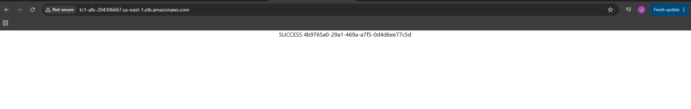

---

## Contents

1. [Architecture](#architecture)
2. [Repository layout](#repository-layout)
3. [Prerequisites](#prerequisites)
4. [Run locally](#run-locally)
5. [Run with Docker](#run-with-docker)
6. [Deploy the infrastructure with Terraform](#deploy-the-infrastructure-with-terraform)
7. [Jenkins server](#jenkins-server)
8. [Jenkins pipeline](#jenkins-pipeline)
9. [Auto scaling and load test](#auto-scaling-and-load-test)
10. [GitOps with GitHub Actions](#gitops-with-github-actions)
11. [Changes to the original code](#changes-to-the-original-code)
12. [Troubleshooting notes](#troubleshooting-notes)
13. [Cost and teardown](#cost-and-teardown)

---

## Architecture

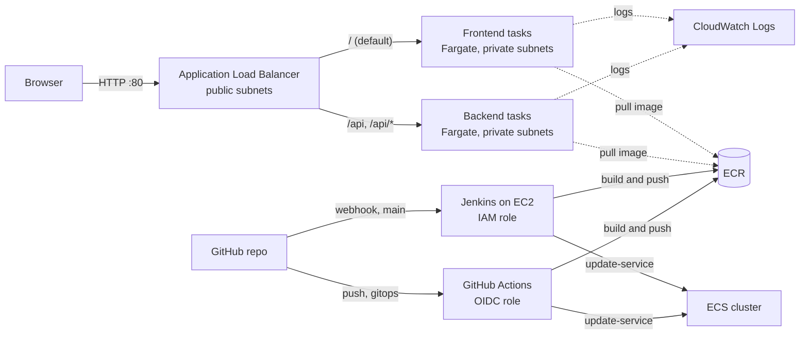

**Request flow:** the browser loads the React app from `/`, and the app calls the backend at `/api/`. Both paths go through one load balancer, so the frontend and backend share an origin and the frontend never needs to know the load balancer's address.

**Network:** a VPC across two availability zones, with two public subnets (load balancer, NAT gateway, Jenkins) and two private subnets (ECS tasks). Tasks have no public IPs. They reach ECR and CloudWatch through a single NAT gateway.

**Security groups:**

| Group | Inbound |
|---|---|
| Load balancer | TCP 80 from anywhere |
| Frontend tasks | TCP 3000 from the load balancer only |
| Backend tasks | TCP 8080 from the load balancer only |
| Jenkins | TCP 8080 from anywhere; TCP 22 from one admin IP only |

**ECS services (frontend and backend):**

| Setting | Value |
|---|---|
| Launch type | Fargate |
| CPU / memory per task | 0.5 vCPU (512) / 1 GB (1024) |
| Min / desired / max tasks | 1 / 1 / 4 |
| Scaling policy | Target tracking, 50% average CPU |

---

## Repository layout

```
.
├── backend/              Express API, Dockerfile
├── frontend/             React app, Dockerfile
├── terraform/            All application infrastructure, plus the Jenkins EC2 and the GitHub OIDC role
├── Jenkinsfile           Jenkins pipeline (main branch)
├── .github/workflows/    GitHub Actions workflow (gitops branch only)
└── docs/screenshots/     Evidence for each phase
```

---

## Prerequisites

- Node.js 16 (the app was last tested on Node 16; on Windows, [nvm-windows](https://github.com/coreybutler/nvm-windows) makes switching easy)
- Docker Desktop
- Terraform 1.5 or later
- AWS CLI v2, signed in to the target account
- An EC2 key pair in the target region (for SSH to Jenkins)

---

## Run locally

```bash
cd backend
npm ci
npm start          # http://localhost:8080
```

In a second terminal:

```bash
cd frontend
npm ci
npm start          # http://localhost:3000
```

The page shows `SUCCESS` followed by the backend's ID.

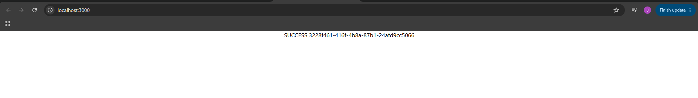

---

## Run with Docker

```bash
docker build -t backend-app ./backend
docker build -t frontend-app ./frontend
docker run -d --name backend  -p 8080:8080 backend-app
docker run -d --name frontend -p 3000:3000 frontend-app
```

With no build argument, the frontend falls back to `http://localhost:8080/`, which works because the React app runs in the browser on the host.

| Backend Dockerfile | Frontend Dockerfile |
|---|---|
| 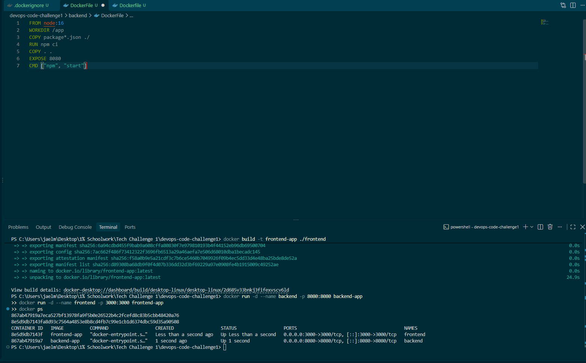 | 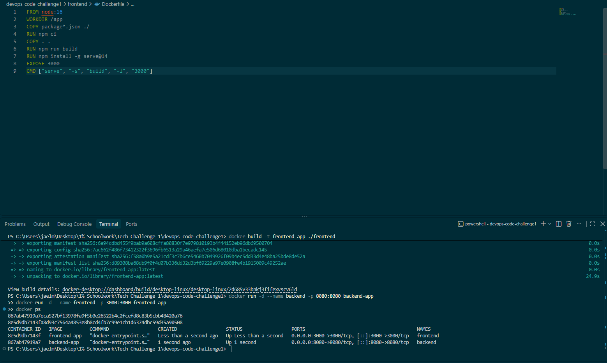 |

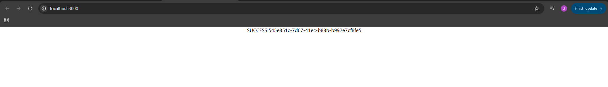

---

## Deploy the infrastructure with Terraform

### 1. Settings

Copy `terraform/terraform.tfvars.example` to `terraform/terraform.tfvars` and fill in:

```hcl
key_name   = "your-ec2-key-pair-name"
my_ip_cidr = "x.x.x.x/32"     # your public IP, allowed to SSH to Jenkins
```

`terraform.tfvars` is in `.gitignore`.

If the AWS account already has a GitHub OIDC provider, also add `create_github_oidc_provider = false`.

### 2. Create the ECR repositories first

The ECS services start from the `:latest` image in each repository, so the images need to exist before the services are created.

```bash
cd terraform
terraform init
terraform apply -target=aws_ecr_repository.frontend -target=aws_ecr_repository.backend
```

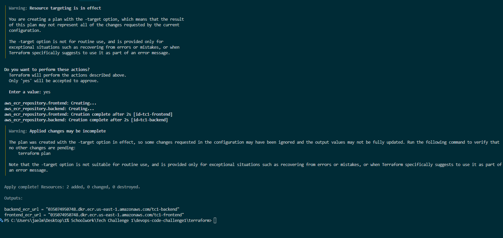

### 3. Push the first images

```bash
REGISTRY=<account-id>.dkr.ecr.us-east-1.amazonaws.com
aws ecr get-login-password --region us-east-1 | docker login --username AWS --password-stdin $REGISTRY

docker build -t $REGISTRY/tc1-backend:latest ./backend
docker build --build-arg REACT_APP_API_URL=/api/ -t $REGISTRY/tc1-frontend:latest ./frontend
docker push $REGISTRY/tc1-backend:latest
docker push $REGISTRY/tc1-frontend:latest
```

On Windows PowerShell, piping the password into `docker login` returned `400 Bad Request`. Passing it as a variable works: `$PW = aws ecr get-login-password ...; docker login --username AWS --password $PW $REGISTRY`.

### 4. Apply everything

```bash
terraform plan
terraform apply
```

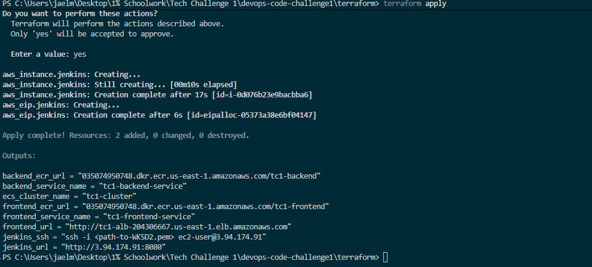

### What Terraform creates

| File | Resources |
|---|---|
| `network.tf` | VPC, 2 public and 2 private subnets, internet gateway, NAT gateway, route tables |
| `security_groups.tf` | Load balancer, frontend, backend, and Jenkins security groups |
| `alb.tf` | Load balancer, two target groups, port 80 listener, `/api` routing rule |
| `ecr.tf` | Two repositories with scan on push and a keep-last-10 lifecycle policy |
| `iam.tf` | ECS task execution role; Jenkins EC2 role and instance profile |
| `ecs.tf` | Cluster with Container Insights, log groups, task definitions, services |
| `autoscaling.tf` | Scaling targets (1 to 4) and CPU target tracking policies |
| `jenkins.tf` | Jenkins EC2 instance and Elastic IP |
| `github_oidc.tf` | GitHub OIDC provider and the deploy role for the `gitops` branch |

| ECS cluster | Load balancer |
|---|---|
| 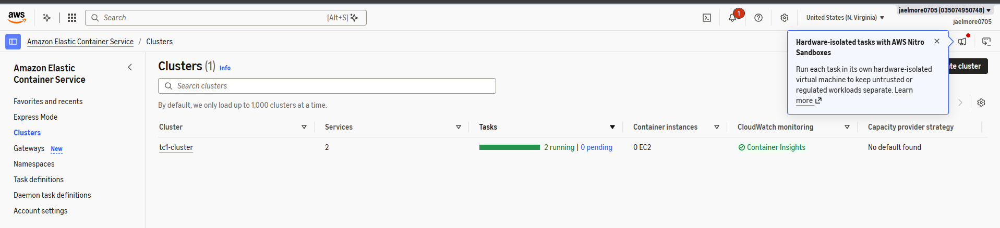 | 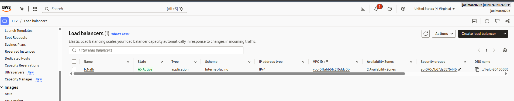 |

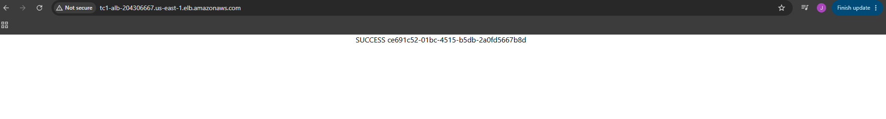

---

## Jenkins server

The challenge allows the Jenkins infrastructure to be created by hand. Here it is created by Terraform (`jenkins.tf`, `iam.tf`) so it can be rebuilt the same way.

| Component | Details |
|---|---|
| Instance | `t3.medium`, Amazon Linux 2023, 30 GB encrypted gp3 volume, public subnet, Elastic IP |
| Instance type choice | `t3.small` (2 GB) can run out of memory during the React production build |
| Security group | 8080 open for the web UI; SSH limited to one admin IP |
| IAM role | `tc1-jenkins-role`: `AmazonEC2ContainerRegistryPowerUser`, plus `ecs:UpdateService` and `ecs:DescribeServices` on this cluster's services only |
| AWS credentials | None stored in Jenkins. The pipeline uses the instance role. IMDSv2 hop limit is set to 2 so the Jenkins container can reach it |
| Docker | Installed by EC2 user data at first boot |

### Install Jenkins

Jenkins runs as a container built from a small custom image that adds the Docker CLI and AWS CLI, so the tools survive if the container is recreated:

```dockerfile
FROM jenkins/jenkins:lts
USER root
RUN apt-get update && \
    apt-get install -y docker.io curl unzip && \
    curl -sSL "https://awscli.amazonaws.com/awscli-exe-linux-x86_64.zip" -o /tmp/awscliv2.zip && \
    unzip -q /tmp/awscliv2.zip -d /tmp && /tmp/aws/install && \
    rm -rf /tmp/aws /tmp/awscliv2.zip && apt-get clean
USER jenkins
```

```bash
sudo docker build -t jenkins-docker .
sudo docker run -d \
  --name jenkins \
  --restart unless-stopped \
  -p 8080:8080 \
  -v jenkins_home:/var/jenkins_home \
  -v /var/run/docker.sock:/var/run/docker.sock \
  --group-add $(getent group docker | cut -d: -f3) \
  jenkins-docker
```

- `jenkins_home` volume: jobs and settings survive container replacement
- Docker socket mount: Jenkins builds images with the host's Docker
- `--group-add`: gives the Jenkins user permission to use that socket

The Jenkins container uses Docker and the instance's IAM role with no stored keys:

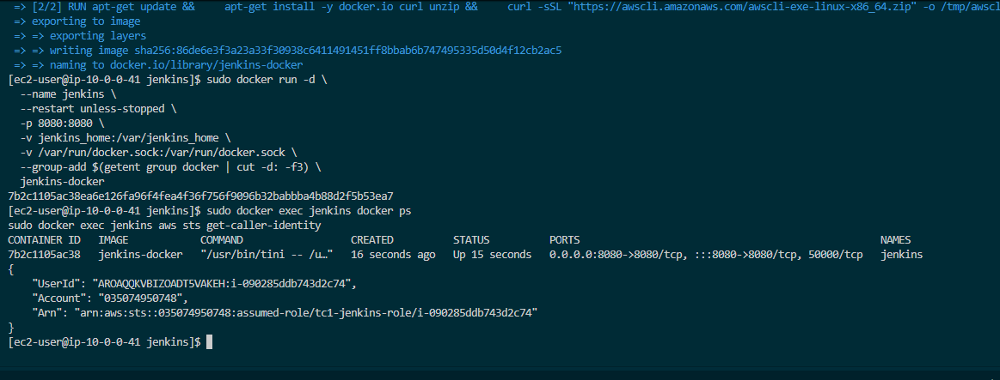

Plugins: the suggested set, plus Pipeline: Stage View.

---

## Jenkins pipeline

`Jenkinsfile` stages:

| Stage | What it does |
|---|---|
| Checkout | Pulls the repository |
| Build images | Builds both images, tagged with the build number and `latest`. The frontend gets `REACT_APP_API_URL=/api/` |
| Log in to ECR | Uses the instance role |
| Push images | Pushes both tags of both images |
| Deploy to ECS | `aws ecs update-service --force-new-deployment` on both services |
| Wait for services to stabilize | `aws ecs wait services-stable`, so a deploy that never becomes healthy fails the build |
| Post | `docker image prune -f` to keep the Jenkins disk from filling |

The job is a **Pipeline from SCM** on `*/main` with **GitHub hook trigger for GITScm polling**. A GitHub webhook posts to `http://<jenkins>:8080/github-webhook/` on every push.

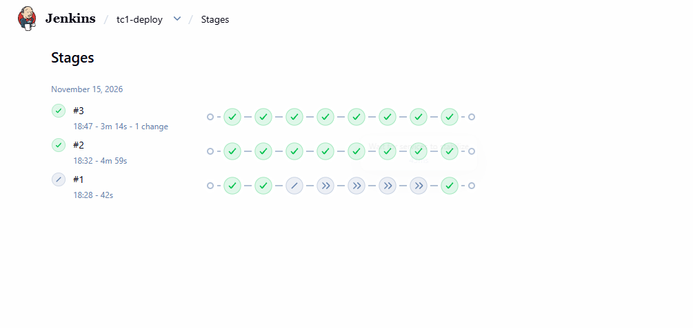

Build #1 was stopped manually during setup. Build #2 was the first full run. Build #3 was started by the webhook:

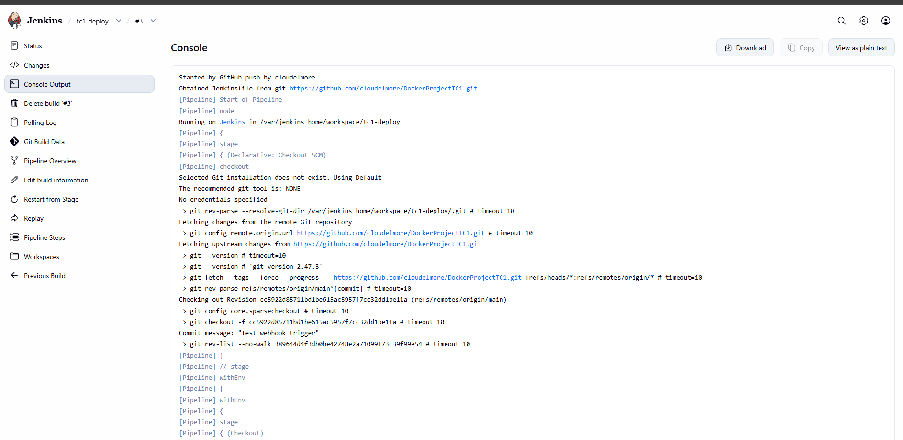

Each build pushes a numbered image, and the backend's ID changes after a deploy because a new task replaced the old one:

| Image tagged with the build number | New backend ID after deploy |
|---|---|
| 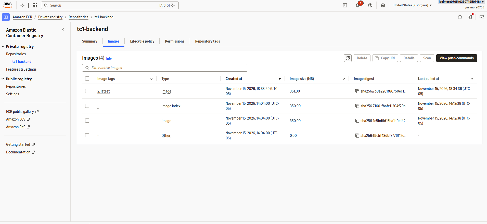 | 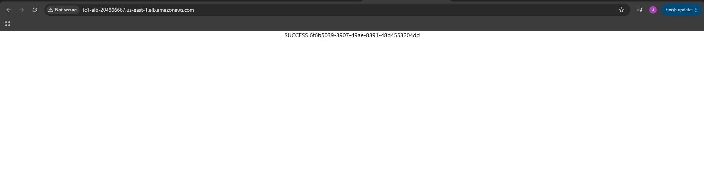 |

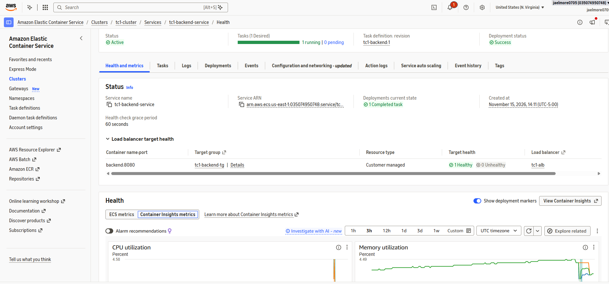

---

## Auto scaling and load test

Each service has a target tracking policy on `ECSServiceAverageCPUUtilization` at 50%. Target tracking creates two CloudWatch alarms per service: **AlarmHigh** (above 50% for 3 minutes) adds tasks, and **AlarmLow** (below 45% for 15 minutes) removes them. Scale-out cooldown is 60 seconds, scale-in cooldown 120 seconds.

### Test

`siege` is not in the Amazon Linux 2023 repositories, so Apache Bench (`httpd-tools`) was used, run from the Jenkins server against the backend path:

```bash
ab -k -c 200 -t 300 -n 10000000 http://<alb-dns>/api/
```

### Results

- **475,660 requests** in 5 minutes at 200 concurrent connections, **0 failed**
- **1,585 requests per second**, median response 108 ms, 99th percentile 273 ms
- Backend CPU went from near 0% to **99.9%**
- AlarmHigh fired, and ECS set the backend's desired count from 1 to **2**. The second task was healthy about a minute later
- About 15 minutes after the test ended, AlarmLow fired and ECS set the desired count back to **1**

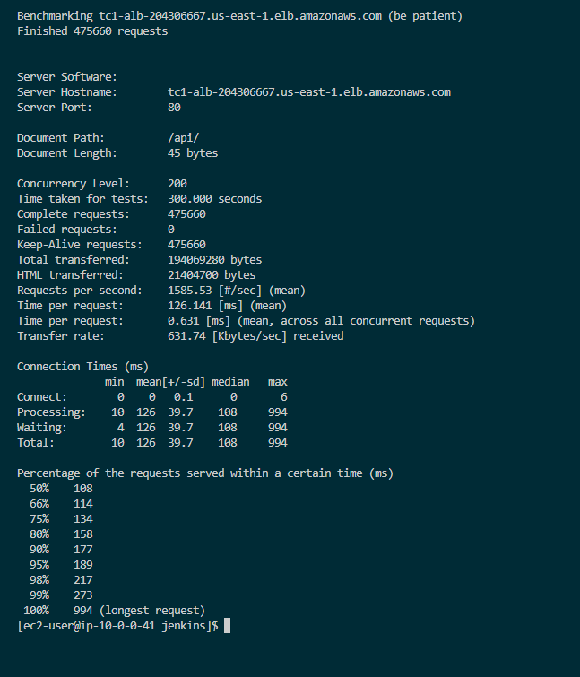

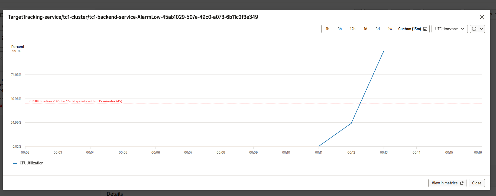

The scaling event names the alarm and the policy that caused it:

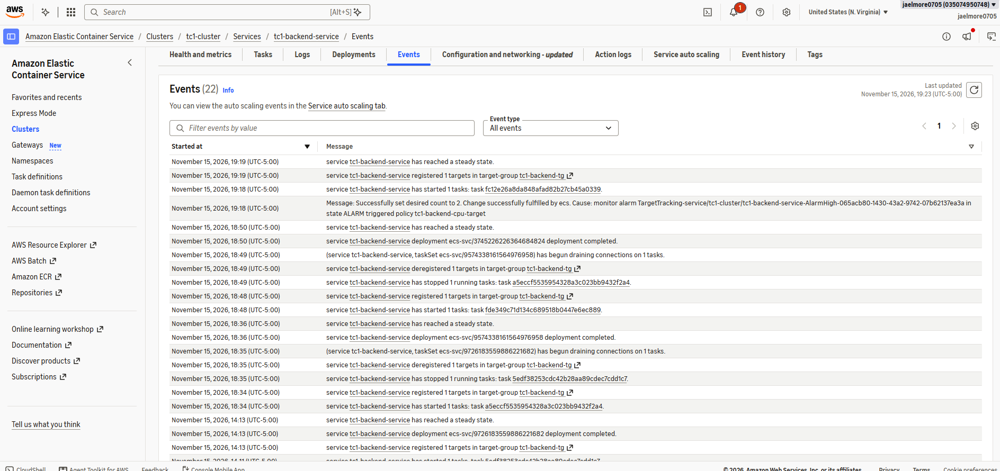

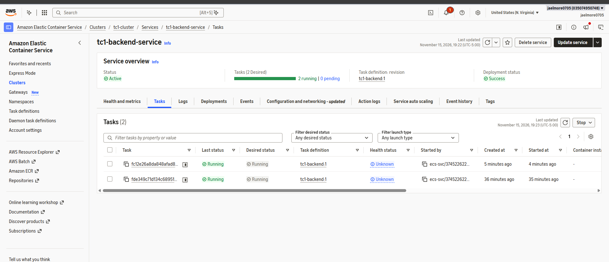

Scale-out at 7:18 PM (AlarmHigh, desired count 2) and scale-in at 7:35 PM (AlarmLow, desired count 1):

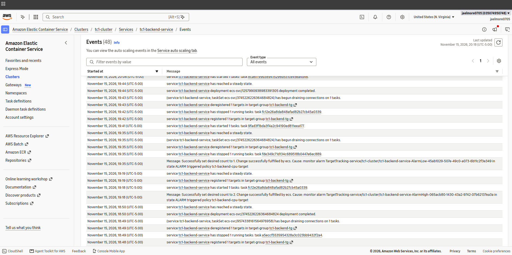

The Service auto scaling tab shows the policy and the full history. The 2:30 PM entry is AlarmLow firing at idle with nothing to remove (`AlreadyAtDesiredCapacity`):

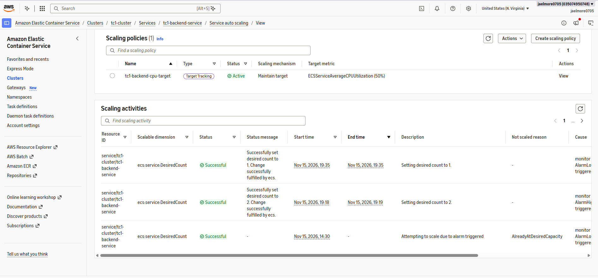

Note: the AlarmLow alarms show **In alarm** whenever a service is idle at its minimum of 1 task. That is expected; there is nothing below the minimum to remove.

---

## GitOps with GitHub Actions

The `gitops` branch removes the `Jenkinsfile` and deploys with `.github/workflows/deploy.yml` on every push to that branch. The workflow builds and pushes both images (tagged `gitops-<run number>` and `latest`), redeploys both services, and waits for them to stabilize.

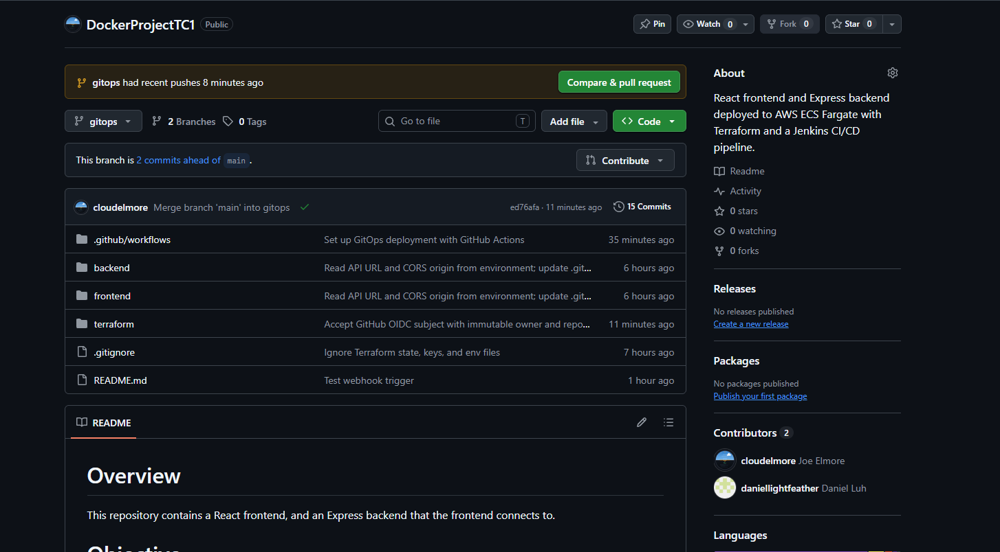

### Authentication with OIDC

No AWS keys are stored in GitHub. The workflow requests a short-lived OIDC token from GitHub, and AWS exchanges it for temporary credentials on `tc1-github-actions-role`. The role's trust policy only accepts tokens for this repository's `gitops` branch, and its permissions are limited to pushing to the two ECR repositories and updating the two ECS services.

Both are defined in `terraform/github_oidc.tf`.

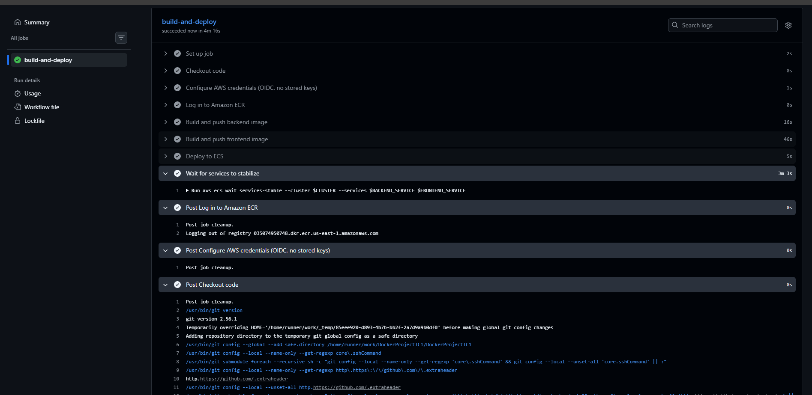


---

## Changes to the original code

| File | Change | Reason |
|---|---|---|
| `frontend/src/App.js` | Displays `SUCCESS <id>` instead of only the ID | Matches the expected output |
| `frontend/src/config.js` | `API_URL` reads `process.env.REACT_APP_API_URL`, falling back to `http://localhost:8080/` | The URL is set at build time, so the same code works locally and on AWS with no edits after deploy |
| `backend/config.js` | `CORS_ORIGIN` reads `process.env.CORS_ORIGIN`, falling back to `http://localhost:3000` | Terraform sets it in the task definition |
| `frontend/Dockerfile` | `ARG` / `ENV REACT_APP_API_URL` before the build; Node 16; `npm ci`; `serve@14` pinned | React reads environment variables when it builds, not when the container starts |
| Both `.dockerignore` files | Exclude `node_modules` and `build` | Keeps Windows `node_modules` out of the Linux image |

---

## Troubleshooting notes

Problems hit during the build and how they were resolved:

| Problem | Cause | Fix |
|---|---|---|
| `npm` builds failed on a newer Node version | The React tooling in this repo predates Node 17 | Installed Node 16.20.2 with nvm-windows |
| `docker build` could not find the Dockerfile | Files were named `DockerFile`; Docker looks for `Dockerfile` | Renamed (two steps on Windows, since a case-only rename is ignored) |
| `docker login` to ECR returned `400 Bad Request` | Windows PowerShell altered the piped password | Passed the password as a variable instead of a pipe |
| Jenkins EC2 failed with `InvalidKeyPair.NotFound` | An IAM access key ID was entered as the key pair name | Created an EC2 key pair; Terraform replaced the instance |
| SSH warned the host identification changed | The instance was replaced but kept the same Elastic IP | `ssh-keygen -R <ip>` |
| GitHub Actions: `Not authorized to perform sts:AssumeRoleWithWebIdentity` | GitHub's OIDC subject included numeric owner and repo IDs (`repo:owner@id/repo@id:...`), which the trust policy did not list | Found the actual subject in CloudTrail Event history and added that format to the trust policy |
| `siege` not available on Amazon Linux 2023 | Not in the default repositories | Used Apache Bench (`ab`) |

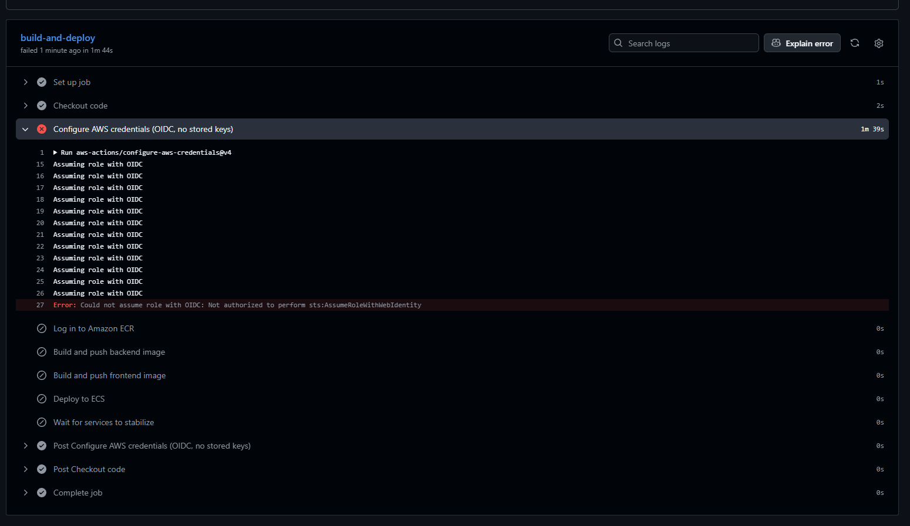

---

## Cost and teardown

Running cost is roughly $3 to $4 per day, mostly the NAT gateway, load balancer, Fargate tasks, and the `t3.medium` Jenkins instance.

To remove everything:

```bash
cd terraform
terraform destroy
```

The ECR repositories use `force_delete`, so they are removed even if they contain images.
